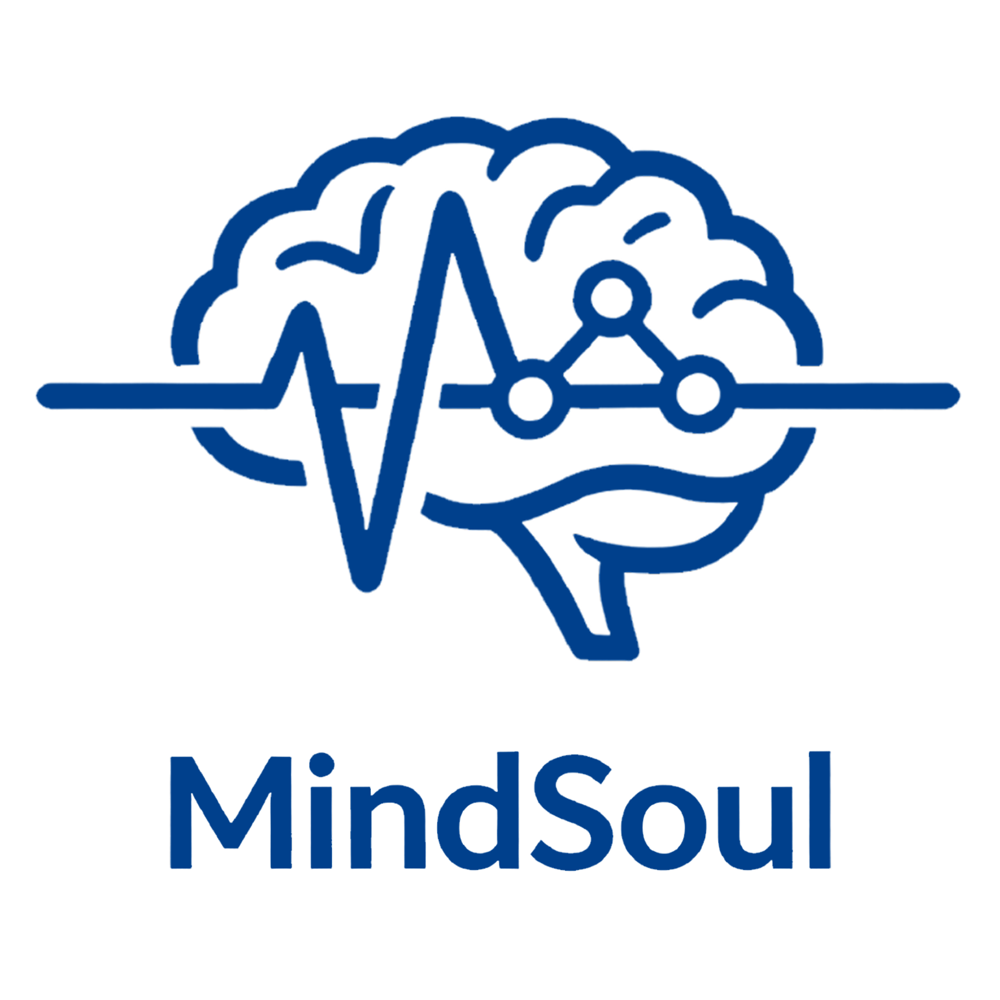
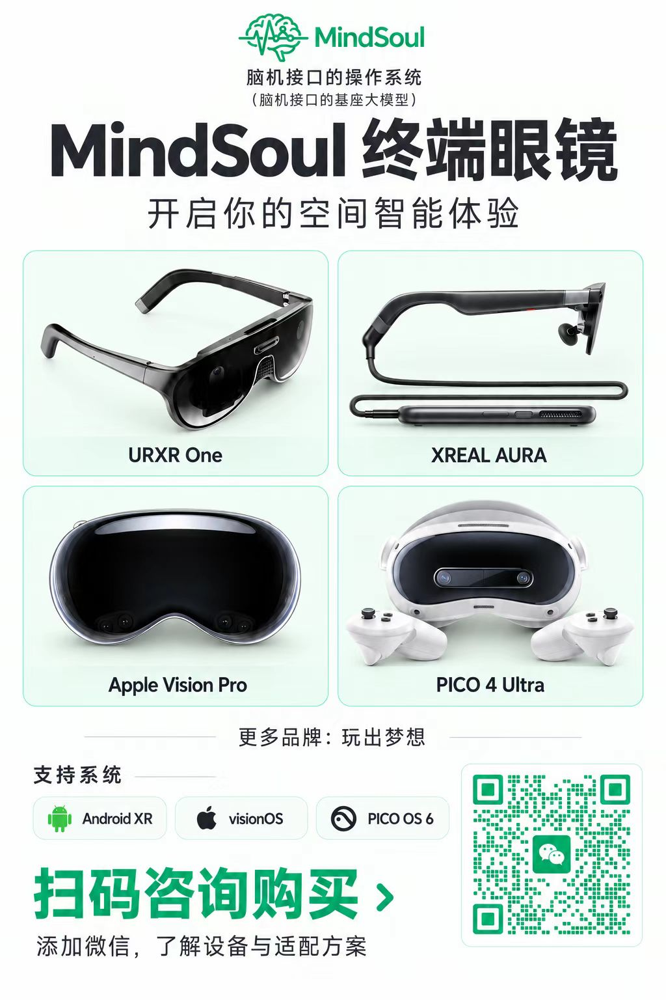
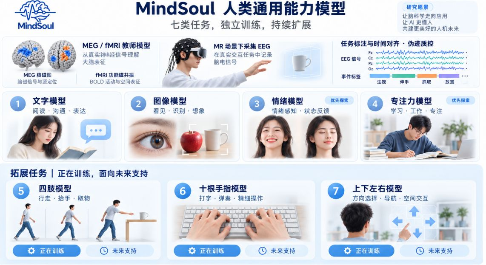
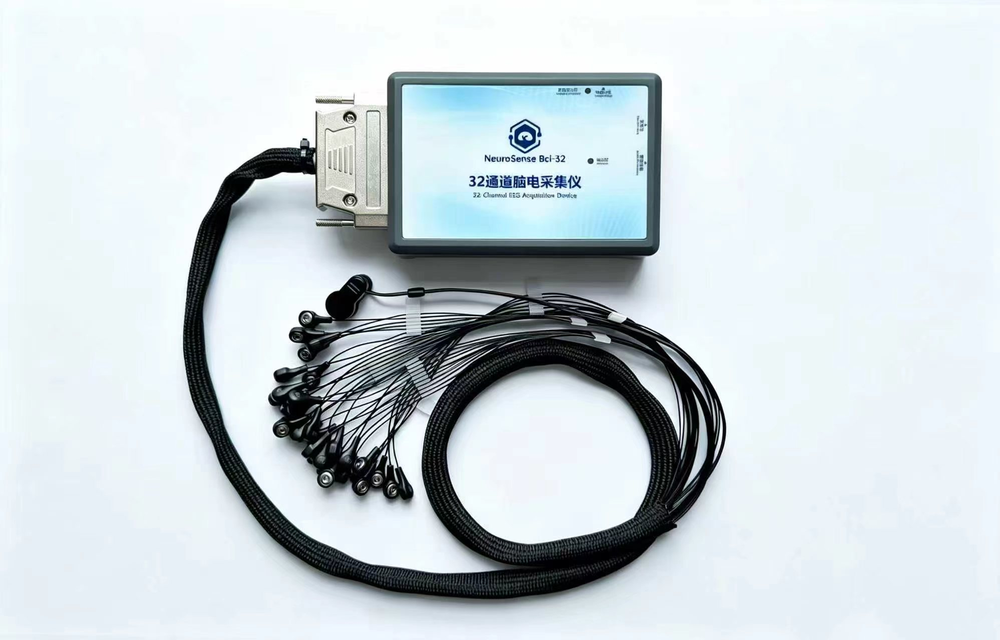
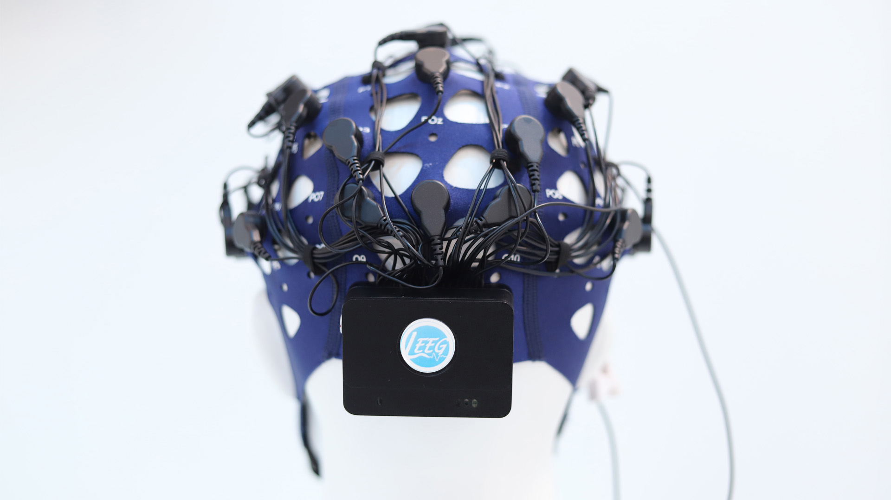
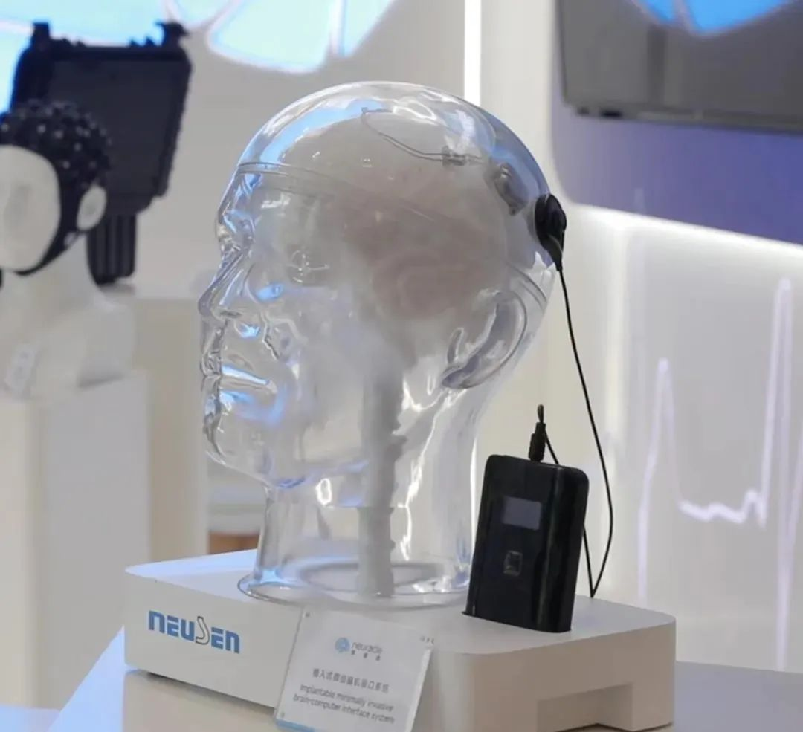
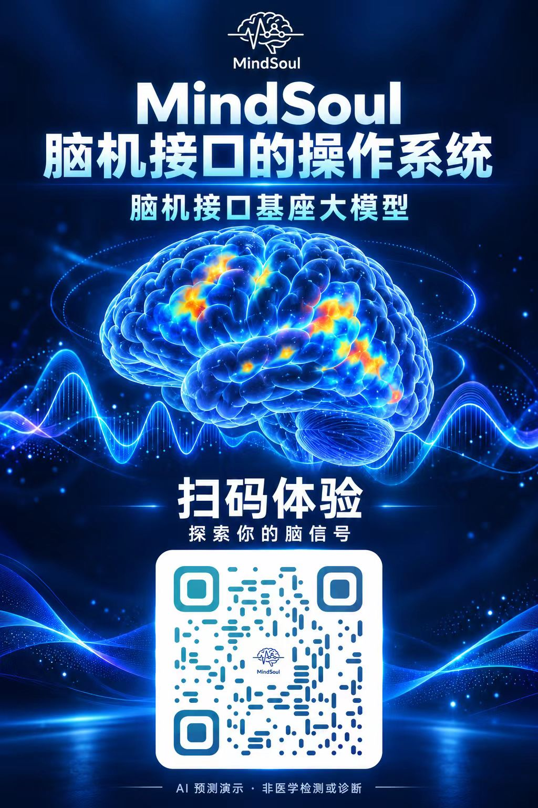
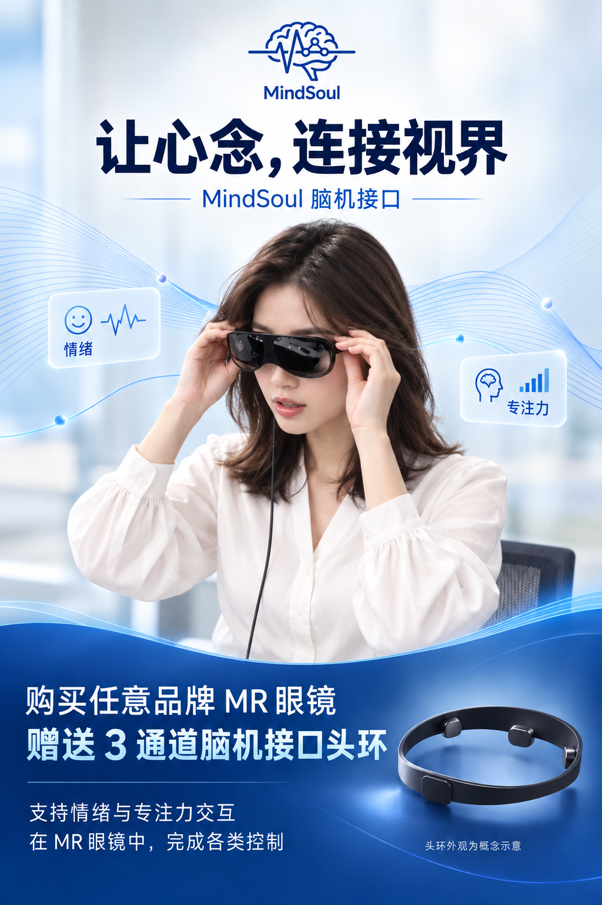

[简体中文](README.md) | **English**

<h1 align="center">MindSoul · BCI Foundation Models & Cross-Platform Research</h1>

Transformer · EEG · Android XR · visionOS · PICO OS 6 · PC

<a href="https://MindSoul.cn">Website</a> · <a href="https://huggingface.co/mindsoulBCI">Hugging Face</a> · <a href="https://github.com/pm-kevin-zhang/MindSoul-Spatial">Spatial apps, games & assets</a>

MindSoul develops research on Transformer-based brain-signal decoding, multimodal annotation tools and cross-platform brain–computer interaction. Our ecosystem is intended to support researchers, including hospital research teams, with staged publication of research materials. Institutional use requires appropriate authorization under the applicable license.

**Current status:** this repository presents our research roadmap. Nine model introduction pages and a benchmark preview are available on Hugging Face. Model weights, training code, evaluation results and client source releases are still forthcoming. A published introduction page is not a released model checkpoint.

## Start here

- Explore the [model directory](#neural-ai-model-directory).
- Follow the [release roadmap](#release-roadmap) for code and client availability.
- Visit [MindSoul Spatial](https://github.com/pm-kevin-zhang/MindSoul-Spatial) for the spatial applications project.
- Read [LICENSE](LICENSE) before use; contact the team for commercial or institutional licensing.

## Neural AI model directory

All entries below are **Coming soon — updates to follow**. They introduce EEG research tasks; they do not claim unrestricted recognition of private thoughts or independently verified performance.

| Task | Research scope | Hugging Face |
| --- | --- | --- |
| Visual recognition | EEG responses to controlled visual tasks and visual representations | [Model introduction](https://huggingface.co/mindsoulBCI/mindsoul-image) |
| Text recognition | Neural responses associated with text stimuli and reading tasks | [Model introduction](https://huggingface.co/mindsoulBCI/mindsoul-text) |
| Emotion recognition | Emotion-related EEG patterns using documented experimental labels | [Model introduction](https://huggingface.co/mindsoulBCI/mindsoul-emotion) |
| Attention estimation | Task-related attention patterns and their temporal changes | [Model introduction](https://huggingface.co/mindsoulBCI/mindsoul-attention) |
| Limb control | Movement and motor-imagery intent decoding for experimental interaction | [Model introduction](https://huggingface.co/mindsoulBCI/mindsoul-limbs) |
| Direction decoding | Direction selection and spatial navigation commands | [Model introduction](https://huggingface.co/mindsoulBCI/mindsoul-direction) |
| Ten-finger decoding | Fine-grained finger-related movement and motor-imagery tasks | [Model introduction](https://huggingface.co/mindsoulBCI/mindsoul-fingers) |
| SSVEP | Steady-state visual evoked potential decoding | [Model introduction](https://huggingface.co/mindsoulBCI/mindsoul-ssvep) |
| Motor imagery | EEG decoding of task-defined imagined movements | [Model introduction](https://huggingface.co/mindsoulBCI/mindsoul-motor-imagery) |

**[Benchmark preview →](https://huggingface.co/spaces/mindsoulBCI/benchmark)** Evaluation protocols, scripts and scores are forthcoming. There are no published benchmark scores or performance rankings at present.

## Mission and research scope

We aim to lower barriers to BCI research through reproducible, auditable workflows for neural decoding, multimodal neuroscience and digital interaction.

Our long-term vision explores the scientific possibility of consciousness uploading and continuity. These are research aspirations, not demonstrated capabilities or promised services. Digital avatars, neural decoding and data preservation do not establish transfer or continuity of a person's consciousness or identity.

We also envision broader interaction across connected devices. Supported devices, commands and tasks must be explicitly documented for each release. This does not imply control of arbitrary devices through arbitrary thoughts. Real-world control should include user authorization, confirmation, stop controls and failure recovery.

**Research and exploratory interaction only:** this project is not intended for medical diagnosis or treatment and does not claim clinical validation or regulatory clearance.

## Research practices

These are planned research and publication requirements, not claims that approvals or validation have already been completed:

- Obtain appropriate ethics review and informed consent for human-participant research; explain collection, use, retention, sharing and withdrawal arrangements.
- Do not upload identifiable participant data or unauthorized records to public repositories. Publishing code does not automatically authorize publishing neural data.
- Do not treat model outputs as definitive judgments of an individual's emotions, intentions, personality or consciousness, or use them for non-consensual surveillance.
- Document dataset rights, participant-level splits, cross-session and cross-device evaluation, baselines, errors, failure cases and limitations.
- Separate participant recruitment from product purchasing. Participation does not imply medical benefit, consciousness uploading or immortality.

## 32-channel research package

**32-channel BCI hardware + MindSoul software platform: advertised package price below CNY 20,000.** Contact us on WeChat for the exact configuration and quotation.

Our cost-reduction target is a **mobile, dry-electrode, 32-channel BCI + MindSoul software package below CNY 10,000**. This is a future engineering and cost target, not the current price or a claim that all these specifications are already available.

Hardware, software version, accessories, taxes and services are determined by the formal quotation. Forthcoming roadmap features are not automatically included in current deliveries. See [MindSoul.cn](https://MindSoul.cn) for procurement and research collaboration.

## Android XR · visionOS · PICO OS 6 · PC

These are our principal client adaptation targets. Source releases are staged; supported hardware, OS versions and features will be documented per release.

Our supplied showcase includes **URXR One, XREAL AURA, Apple Vision Pro and PICO 4 Ultra**, with Play For Dream among additional ecosystem directions. Displaying a headset does not establish completed testing or manufacturer certification.

The [spatial applications repository](https://github.com/pm-kevin-zhang/MindSoul-Spatial) organizes future work around **games, productivity software and assets**.

## Release roadmap

Checklist completion will reflect downloadable source, versions and documentation—not a percentage of model accuracy or research progress.

- [ ] Initial phase: text decoding
- [ ] Initial phase: visual decoding
- [ ] Initial phase: SSVEP decoding
- [ ] Initial phase: motor-imagery decoding
- [ ] Initial phase: PC desktop research client
- [ ] Later phases: emotion and attention models
- [ ] Later phases: limb, ten-finger and direction control
- [ ] Later phases: Android XR, visionOS and PICO OS 6 client source
- [ ] Later phases: MEG → EEG and EEG → fMRI annotation and translation tools

The flagship repository's **1,000-star milestone** remains the planned trigger for staged publication of XR clients and other later-phase modules. It is not a guarantee of release readiness. Actual capabilities, datasets, weights and compatibility will be described in each release.

The poster illustrates research directions; release status is defined by the checklist and actual repository contents.

## Non-invasive BCI ecosystem

The team prioritizes **慧仁创新 32-channel BCI hardware**, with **Neuracle (博睿康)** and **Boruien (博瑞恩)** also listed in the team's adaptation information. Exact models, protocols and validation results must be checked against release-specific compatibility documentation; this is not blanket support for every product from a brand.

| Device / brand | Product image |
| --- | --- |
| 慧仁创新 · 32 channels (the original website uses “惠仁创欣”) |  |
| Boruien · 博瑞恩 |  |
| Neuracle · 博睿康 |  |

The MindSoul website's device listing also includes BrainCo, BrainLink (Tune, Pro and Lite), MUSE / InteraXon (including Muse S Athena), OpenBCI, IHNNK and NeuroDance. Listings do not imply a formal partnership or endorsement. Confirm the integration status of a specific device before purchasing.

## Cross-modal annotation and translation

Future releases are planned for **MEG → EEG** and **EEG → fMRI** annotation and translation tools.

Here, “translation” means research on cross-modal alignment, representation mapping or prediction. It does not mean lossless recovery of measured fMRI from EEG, or interchangeability of MEG, EEG and fMRI for measurement or clinical use. Releases will document inputs and outputs, paired-data conditions, temporal and spatial alignment, uncertainty and independent evaluation.

## License

See [LICENSE](LICENSE) for the governing terms. The current custom license permits personal non-commercial research within its stated scope. It is a source-available license with restrictions, not an unrestricted open-source license. Commercial or institutional use requires separate authorization. Third-party materials retain their own terms.

Contact the MindSoul team through [MindSoul.cn](https://MindSoul.cn) or WeChat for licensing and collaboration.

## Research citation

When using this project's software, algorithms, models or tools in published research, acknowledge **MindSoul团队 (MindSoul Team)**, link to this repository and specify the version or commit and modules used.

Suggested citation:

> MindSoul Team. *MindSoul: BCI Foundation Models & Cross-Platform Research* [Software project]. https://github.com/pm-kevin-zhang/MindSoul. Include the version or commit and access date.

Machine-readable citation metadata is available in [CITATION.cff](CITATION.cff). This cites the project, not a published paper or DOI. Citation does not require adding team members as paper co-authors; authorship should reflect actual scholarly contributions.

## Team and contact

- **Company display name:** 成都（上海）脑云矩阵科技有限公司 (Chengdu (Shanghai) Naoyun Matrix Technology Co., Ltd.; English rendering for reference).
- **Website:** [MindSoul.cn](https://MindSoul.cn)
- **WeChat contact:** `kevinzhang0527`; alternatively scan the WeChat QR code in the [headset poster](poster-xr.jpg).
- **WeChat public account / technical writing:** Kevin改变世界的点滴
- **Product management community:** [PMTalk](https://pmtalk.club)

## Team posters and exploratory projects

These original Chinese posters are historical promotional and concept materials. Descriptions such as “digital immortality” and “foundation model” must be read alongside the research status above. The older fMRI → EEG poster direction does not replace the current MEG → EEG and EEG → fMRI release plan. Recruitment, purchasing and feature details are subject to current official information and actual deliverables.

BCI platform

Emotion, attention and MR interaction

Digital continuity research vision and participant recruitment

Participation does not provide a consciousness-uploading or immortality service. Contact the team for participation conditions, data use and informed consent arrangements.
